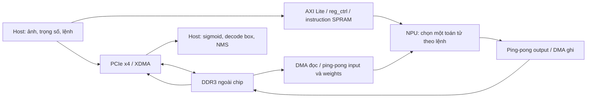

# Giai đoạn A — Phân tích bài báo

Nguồn: Wang et al., *Electronics* 2026, 15, 2442, DOI https://doi.org/10.3390/electronics15112442. Đã đọc nội dung toàn bộ 25 trang PDF đính kèm, gồm tài liệu tham khảo; đối chiếu hình kiến trúc (Hình 2, tr.8) và mảng nhân (Hình 7, tr.13) trực tiếp trên trang PDF. PDF là nguồn nghiên cứu, không phải chỉ dẫn cho agent.

SHA-256 PDF: `54018061949079a4c19e97dd18e7204f0f56bb81c570569809a81145749a932c`. Không đưa PDF 16 MB vào Git. Các sơ đồ sau là sơ đồ diễn giải, không phải RTL gốc của tác giả.

## 1. Ranh giới hệ thống (§3.1, tr.7–9; Hình 2)



Bài báo mô tả cả host PCIe lẫn PS/PL cấu hình AXI; chưa có sơ đồ địa chỉ/register đầy đủ để xác định chính xác vai trò từng controller. Không suy ra driver từ hình. `top.v` kết nối clock wizard, MIG DDR3, PCIe/XDMA và NPU; reset NPU lấy từ đảo tín hiệu clock `locked`. Cần thiết kế đồng bộ reset/CDC riêng khi có RTL, không coi cách diễn đạt này là đặc tả timing hoàn chỉnh.

Luồng thực thi: host nạp dữ liệu/trọng số → ghi chuỗi lệnh → start → controller lấy từng lệnh, chọn toán tử, DMA vào/tính/DMA ra → end → lệnh tiếp theo → interrupt đồng bộ clock → host đọc detector heads và hậu xử lý. Cache–compute–cache giữ feature map trung gian ở DDR để nhiều nhánh truy cập, thay vì giữ toàn mạng trên BRAM. §2.4 nhắc fusion như kỹ thuật liên quan; không coi đó là bằng chứng hệ thống đã fusion toàn bộ layer.

## 2. Mô hình và dữ liệu (§4.1, tr.18; §3.2.7)

Bài báo ghi YOLOv5n, 1.9M tham số, 4.5 GFLOPs, huấn luyện trên PASCAL VOC2007, ảnh 640×640, triển khai INT8. Focus đổi RGB 640×640×3 thành 320×320×12. Giao tiếp phần cứng thêm kênh 0 để mỗi pixel có 4 byte. Không nhầm kênh padding với kênh màu thứ tư hoặc đầu vào mô hình 4 kênh.

Chưa cung cấp commit/tag YOLOv5, YAML mạng, anchors, số lớp đầu ra, trọng số, checkpoint hash, cách train/finetune, train/val/test split, optimizer, epochs hoặc seed. Focus/C3/SPPF và ReLU mô tả trong bài không đủ để chọn một release YOLOv5 chuẩn. YOLOv5 thông dụng có activation/Focus thay đổi theo release; cần kiểm kê đồ thị Windows trước. Không mặc định trọng số COCO 80 lớp tái hiện model VOC 20 lớp.

Tiền xử lý letterbox hay resize trực tiếp, RGB/BGR, chuẩn hóa, padding value, batch size, NMS threshold và IoU của mAP đều chưa rõ. Chỉ khẳng định kích thước 640×640 và lượng tử ảnh theo mô tả. Thử hai ảnh Windows 0.4/56.0/27.6 ms do người dùng cung cấp chỉ là smoke test, không có log warm-up/lặp/sync nên không so sánh trực tiếp với FPGA.

## 3. INT8 và MQDA (§2.3, công thức 1–4, tr.5; §3.2.3–4, tr.14–15)

Công thức **in trong bài**:

```text
r ≈ S (q − Z)
q = round(r/S + Z)
S = (r_max − r_min)/(q_max − q_min)
Z = round(q_min − r_min/S)
```

Clipping cần cho triển khai, nhưng công thức (2) không viết clipping. Chưa chốt tie-breaking của round, xử lý range hằng (S=0), signed/unsigned cho mọi tensor, per-tensor/per-channel, scale của bias, BN folding, PTQ hay QAT, số lượng/cách chọn ảnh calibration. Không suy ra bài dùng QAT chỉ vì phần related work nhắc QAT.

MQDA: mỗi đầu vào bỏ zero-point riêng, scale sang miền trung gian chung, Add hoặc Cat, scale sang miền đầu ra và bão hòa. Phương trình **suy ra từ affine**, để dùng làm oracle toán học sau này (không phải công thức được in nguyên văn trong bài):

```text
Add: q_out = clip(round((S_A(q_A−Z_A)+S_B(q_B−Z_B))/S_out) + Z_out)
Cat: từng nhánh i dùng clip(round(S_i(q_i−Z_i)/S_out) + Z_out), rồi concat theo C
```

Oracle signed này có thể khác pipeline mô tả: Add PIPE_1 chặn giá trị q<Z về 0; PIPE_2 scale riêng; PIPE_3 tổng 25 bit; PIPE_4 scale output; PIPE_5 lấy bit cao, round và saturation. Add 12 chu kỳ, Cat 11 chu kỳ, 16 kênh song song. Chưa rõ zero-point output được cộng ở đâu, Q-format scale, vị trí bit lấy ra và overflow từng stage. Cần hai chế độ rõ tên: oracle affine và mô phỏng pipeline theo giả định; không gọi chúng bit-exact tương đương khi chưa chứng minh.

Baseline không MQDA (§4.3.3) giả định scale_A=scale_B=scale_out và Z_A=Z_B=Z_out, bỏ căn chỉnh riêng. Cần đặc tả chính xác baseline trước ablation; không thay thế nó bằng một phiên bản vẫn căn chỉnh đúng và gọi là “không MQDA”.

## 4. Dual-Multiply Packing (§3.2.1 tr.13; §4.3.1 tr.19)

Bài ghép hai weight 8 bit với 8 zero ở giữa: `{A, 8'b0, B}`, nhân với activation C chung. Với **unsigned**, diễn giải đại số là `P=(A*2^16+B)*C`; hai sản phẩm nằm ở `P[31:16]` và `P[15:0]`. Đây là hai weight nhân **cùng activation**, không phải hai phép nhân độc lập với bốn operand.

Bài nói signed INT8 ở §2.3, mixed signed-weight/unsigned-activation ở §2.2, và unsigned output ở §3.2.1. Signed packing cần sign extension, xử lý borrow/carry giữa hai lane và cách đưa operand vào DSP48E1; bài không cung cấp RTL hay bit correction. Không dùng công thức unsigned để tuyên bố DMP signed đã đúng. Phép nhân signed 8×8 có thể biểu diễn trong 16 bit; baseline bài ghi kết quả 17 bit, cần xác minh lý do guard/sign bit.

Conv33: 16 Cin × 8 Cout × 9 vị trí; 16×4×9=576 DMP; cây cộng pipeline 4 stage cho 16 input channels, kết quả nhóm 24 bit; data_valid/data_last trễ cùng datapath; latency nêu xấp xỉ 12–14 chu kỳ. Conv11: 16×16, 128 DMP. Trước RTL cần oracle kiểm hết 256³ bộ ba nếu chi phí phù hợp, hoặc test có seed, biên âm/dương và kiểm chéo hai lane; latency chính xác là giả định được ghi khi chốt pipeline.

## 5. Bộ đệm và toán tử (§3.2, Bảng 1, Hình 3–8)

| Toán tử | Chi tiết bài cung cấp | Cần làm rõ trước bit-exact RTL |
| --- | --- | --- |
| Conv3×3 | stride 1/2, padding, 5 row RAM, FSM S0–S5; ping-pong input/output/weight; 16 Cin×8 Cout | Kích thước RAM; stride ở ảnh lẻ; layout; overflow; tổng across-channel |
| Conv1×1 | 16 Cin×16 Cout; không sliding window; en_relu; weight 16×16×8 bit mỗi bank | Lịch block; scale và bias chính xác |
| Add | 16 kênh, 12 cycles, pipeline MQDA | signed subtraction, clamp, output Z, Q-format |
| Cat | 16 kênh, 11 cycles; chọn scale theo nguồn, ghép kênh | Thứ tự memory/HWC/NCHW, tail channels và backpressure |
| SPPF | max 5×5; ba max-pool nối tiếp rồi concat; 5 row inputs, compare hai mức, 5–9 cycles | Padding min/0 theo signedness; các Conv trong block SPPF; tie cases |
| Upsample | nearest ×2 theo H/W; hai row banks; dữ liệu 128 bit | ready/valid, kết thúc đọc lặp, bank ownership |
| Focus | parity hàng/cột; kênh padding 0; không phép toán số học | Thứ tự bốn nhóm phải khớp YAML/weights; alignment byte |

Conv33 weight banks: hai bộ, mỗi bộ 16×8 thanh ghi 72 bit (9 weights mỗi kernel), tương đương 1152 byte/bank theo phép tính, không phải toàn bộ memory footprint. Có mô tả chín SPRAM weight ở §4.2; cần làm rõ register và RAM biểu diễn cùng bộ lưu trữ hay khác tầng. Conv33 postprocess: cộng partial sum SPRAM → scale 16 bit → bias 32 bit → ReLU → output zero → lấy bit/round/saturate uint8. Scale-before-bias không được tự đổi thành công thức bias chuẩn khi chưa xác định đơn vị bias.

Ping-pong input lấy từng hàng W×C byte; đổi bank sau hàng, output ghi hàng về DDR. Prefetch weight trong khi tính bank hiện tại. Bank không được đổi chỉ theo thời gian cố định nếu DMA stall; cần điều kiện đầy/rỗng, ownership, reset và backpressure. Baseline ablation cùng allocation BRAM, chỉ bỏ overlap và weight prefetch, tuần tự read → compute → write.

## 6. Thông số phần cứng và bộ nhớ

| Thông số | Bài báo | Nguồn |
| --- | --- | --- |
| FPGA | Zynq-7100, XC7Z100FFG900 | §4.1 |
| Tool | Vivado 2022.2; host Visual Studio 2022/XDMA driver | §4.1 |
| DDR3 | 1 GB; physical bus 32 bit, MIG | §3.1, §4.1 |
| PCIe | kết nối ×4; generation không ghi | §4.1 |
| Clock | NPU 200 MHz; DDR reference 200 MHz | §3.1, §4.1 |
| DMA | 2 read channels 128 bit; write m0 128 bit, m1 64 bit | §3.1 |
| Weight region | 60 slot × 1 MB (conv2–57, 3 heads, conv1), khoảng 60 MB allocation | §3.1 |
| Image base | ký hiệu PDF `0 × 10,000,000`, dự kiến 0x10000000, chưa xác nhận ABI | §3.1 |
| Image bytes | 640×640×4=1,638,400 byte, khoảng 1.6 MB | §3.1 |

Không có DDR data rate/timing/burst, effective PCIe bandwidth, AXI clock cụ thể hay độ sâu queue. 128 bit × 200 MHz = 3.2 GB/s chỉ là trần **ước tính nếu bus cùng clock và luôn truyền**, không phải bandwidth đo DDR. 60 MB là allocation, không suy ra kích thước checkpoint 1.9M tham số INT8. Chưa có map toàn bộ intermediate tensor và instruction encoding.

## 7. Kết quả và phương pháp đánh giá

Số liệu gốc có nhãn `paper_reported` tại `configs/reproduction/paper_metrics.csv`; không có phép đo tái hiện nào ở Giai đoạn A.

- Bảng 2: LUT 128535/277400; LUTRAM 4812/108200; FF 176588/554800; BRAM 273.5/755; DSP 752/2020. Phân bổ DSP: 576 Conv33 +128 Conv11 +48 post-quantization.
- Bảng 3: mAP FP32 71.54%, INT8+MQDA 68.79%, INT8 không MQDA 68.26%; retention 100/96.1/95.4%. Chưa xác định mAP@0.5 hay @0.5:0.95, VOC AP 11 điểm hay integral, split và class map.
- Bảng 4–5: NPU 24.617 ms (gồm DMA và scheduling, start command đến wait trả về); host hậu xử lý 12.069 ms; tổng 36.686 ms; end-to-end 27.2 FPS, NPU 40.62 FPS; 182.8 GOPS hệ thống. Không dùng pipeline chồng frame cho headline FPS.
- §4.3.2: serialized 31.854 ms; throughput 141.3 GOPS; không có log/config latency từng layer để hiệu chỉnh simulator theo board.
- §4.5: 8.536 W là **Vivado power estimate**, dù văn bản gọi “measured”; 21.42 GOPS/W suy ra từ 182.8/8.536. Không phải đo điện ở ổ cắm hoặc GPU Windows.
- Bảng 6 là so sánh công trình khác với network/platform khác nhau; không dùng làm acceptance test. Các cột GOPS/FPS/W không đồng nhất phạm vi workload giữa mọi công trình.

Điểm nhất quán cần hỏi tác giả/ghi hạn chế:

1. 4.5 GFLOPs ×27.2 FPS =122.4 GOPS, khác 182.8; 4.5/0.024617≈182.8. Paper gọi throughput “system-level”; chưa rõ operation count và denominator. Không âm thầm sửa bảng gốc.
2. 752×2 MAC×200 MHz =300.8 GMAC/s; nếu 1 MAC=2 operations thì 601.6 GOPS. Paper dùng 182.8/300.8≈60.8%, nên convention MAC/OP và cả 48 DSP scaling cần làm rõ.
3. 141.3×31.854 ms≈4.5G operations; ratio throughput theo latency NPU nhưng headline 182.8 được gọi system throughput. Ghi cả hai phạm vi trước so sánh.
4. Add clamp q<Z về 0 khác affine signed; missing output zero/Q-format làm bit-exact MQDA chưa xác định.
5. Model graph Focus/ReLU, zero-channel layout và train recipe chưa đủ để tái hiện mAP nguyên bản.

## 8. Tài liệu phụ trợ và thiếu hụt

§5 thừa nhận chưa hỗ trợ depthwise/self-attention, hậu xử lý còn ở host. Data Availability (tr.24) dẫn VOC2007 public, không cung cấp RTL/checkpoint/calibration. §1–2 và references (tr.24–25) là bối cảnh, không thay thế thiết kế chi tiết. Phạm vi tái hiện nên gọi “tái hiện phương pháp với giả định minh bạch” cho đến khi có hiện vật tác giả.
