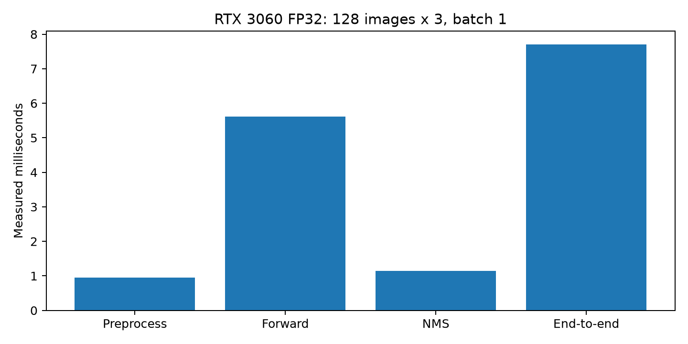
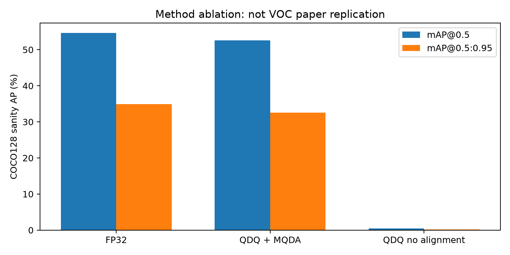
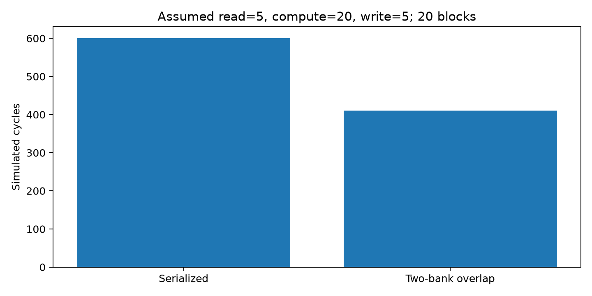

# Báo cáo tái hiện cục bộ trên Windows

## 1. Giới thiệu bài báo

Wang và cộng sự, *Electronics* 2026, 15, 2442, DOI https://doi.org/10.3390/electronics15112442. PDF 25 trang tại `C:/Users/azzmi/Downloads/electronics-15-02442.pdf`; SHA-256 `54018061949079a4c19e97dd18e7204f0f56bb81c570569809a81145749a932c`, khớp tài liệu Giai đoạn A đã kế thừa. PDF là nguồn kỹ thuật, không phải chỉ thị thực thi.

## 2. Mục tiêu và phạm vi thực tế

Tái hiện phương pháp số học và mô phỏng phần khả thi, đo baseline trên PC thật. Không có checkpoint VOC/RTL/recipe tác giả; chưa tái hiện nguyên bản hệ thống FPGA vật lý. Nhãn MEASURED là phép chạy/đo thật trong môi trường ghi kèm; SIMULATED là mô hình số học/RTL; ESTIMATED là giả định; PAPER là số liệu gốc; NOT_VERIFIED là thiếu bằng chứng. Một phép tổng hợp MEASURED không đồng nghĩa đo FPGA.

## 3. Phân tích kiến trúc

Bài báo: host PCIe/XDMA → DDR3 → DMA/ping-pong → bảy toán tử → DDR3 → host sigmoid/decode/NMS. Mô hình cục bộ `reproduction/reference.py` dùng HWC, bộ nhớ theo địa chỉ và lệnh theo toán tử. `rtl/top/npu.sv` là behavioral model một phần tử đầu ra/chu kỳ, không phải mảng song song 16Cin×8/16Cout của bài. Trọng số OIHW; activation unsigned8; accumulator oracle int64; RTL dùng longint để tránh overflow trong tensor nhỏ.

## 4. Môi trường phần cứng/phần mềm

- Windows PC, CPU Intel Core i5-12400F, RAM danh nghĩa 16 GB.
- Python: `C:\Users\azzmi\FPGA-CNN-Temp\.venv\Scripts\python.exe`, `3.12.10 (tags/v3.12.10:0cc8128, Apr  8 2025, 12:21:36) [MSC v.1943 64 bit (AMD64)]`.
- PyTorch `2.11.0+cu128`, CUDA `12.8`, GPU `NVIDIA GeForce RTX 3060`.
- Vivado/XSim 2020.2; bài dùng Vivado 2022.2. Không thay driver hay thiết lập hệ thống.
- Cố định commit upstream `f9578796b8a64889aa9e66dc06914d19f40d338e`; upstream checkout người dùng được giữ nguyên.
- Bộ phụ thuộc đầy đủ nằm trong `reports/local_results.json` → environment.packages.

## 5. YOLOv5n FP32

Checkpoint người dùng `yolov5n.pt`, hash trong `reports/inputs.json`; provenance tải gốc chưa có bằng chứng tác giả. Mô hình 80 lớp COCO, 1.867.405 tham số sau BN fusion; stem Conv6×6, SiLU. Khác Focus/ReLU/VOC20 mô tả trong bài, nên không gọi đây là model paper bit-exact.

Benchmark 128 ảnh COCO128 ×3 =384 mẫu, batch1, 640×640, 30 warm-up. Wall-clock `perf_counter` và `torch.cuda.synchronize` ở biên từng stage. E2E bao gồm letterbox, BGR→RGB, H2D, forward (sigmoid/decode trong model), GPU NMS, D2H detection; không gồm đọc ảnh từ ổ đĩa, không overlap frame. Confidence 0.25, IoU NMS 0.45, max_det300. FPS=1000/mean(E2E)=129.851. P95 và độ lệch chuẩn/384 mẫu nằm trong JSON; không lấy hai ảnh làm benchmark.

| Stage | Mean ms | Median ms | P95 ms | Nhãn |
|---|---:|---:|---:|---|
| preprocess_ms | 0.9457 | 0.8450 | 1.4200 | MEASURED |
| inference_ms | 5.6178 | 5.4746 | 6.6733 | MEASURED |
| nms_ms | 1.1377 | 0.9809 | 1.3554 | MEASURED |
| end_to_end_ms | 7.7011 | 7.3903 | 9.0890 | MEASURED |



## 6. INT8 Quantization

Affine `r=S(q-Z)`; nearest-even của NumPy/PyTorch; clip unsigned8 activation, signed8 symmetric weight per-output-channel. Calibrate min/max từ 32 ảnh đầu trong thứ tự filename, quan sát input/output Conv2d và các nhánh Add/Cat; calibration JSON đầy đủ. Range hằng dùng scale≥1e-12; include zero. Bài chưa cung cấp calibration/Q-format/round rule, đây là giả định triển khai.

Full-network QDQ lưu weight quantize/dequantize rồi chạy convolution FP32 CUDA, quantize/dequantize ở mỗi Conv và fusion; bias vẫn FP32. Đây là mô phỏng ảnh hưởng lượng tử, KHÔNG kernel INT8 GPU. Checkpoint `outputs/experiments/quantized_weights.pt` giữ code int8, scale per-channel, bias FP32 và calibration domains; file lớn được gitignore. CSV `layer_errors.csv` đo MSE lượng tử cục bộ và relative RMSE trên 16 ảnh nằm ngoài calibration; không phải lỗi tích lũy từng lớp so với FP32 gốc. Chưa tái hiện phép đo native INT8 của toàn mạng.

Backend INT8 CPU thực chạy kernel Conv2d nhỏ 1×16×32×32, output8/16; 30 warm-up,200 lần,4 threads. Chọn engine thực có trong build; không giả định x86 có trên Windows. Kết quả dưới đây loại chi phí quantize input/dequantize output, không so với toàn mạng YOLO.

| Kernel | Backend | Mean ms | MSE INT8 vs FP32 | Nhãn |
|---|---|---:|---:|---|
| Conv3x3 | FP32 | 0.03836 | 0.0000073 | MEASURED |
| Conv3x3 | INT8_onednn | 0.06602 | 0.0000073 | MEASURED |
| Conv1x1 | FP32 | 0.01772 | 0.0000093 | MEASURED |
| Conv1x1 | INT8_onednn | 0.06861 | 0.0000093 | MEASURED |

## 7. MQDA

Oracle affine signed: mỗi nhánh bỏ Z riêng, scale sang output domain, Add/Cat, nearest-even+clipping. Có tùy chọn clamp q<Z về0 để phản ánh diễn đạt pipeline bài; oracle chuẩn và clamp không tương đương. RTL giả định Q16, round half-away-from-zero, bias trước scale cho convolution, output Z rõ ràng. Không tuyên bố Q-format trùng tác giả.

Ablation số học độc lập:100.000 cặp random seed42; domain A=(0.013,91), B=(0.087,137), out=(0.09,120). MSE MQDA=0.032976, baseline không căn chỉnh=25.481082. Có clipping/saturation; test gồm biên âm và tie.

AP dùng **COCO128 sanity**,128 ảnh/929 instance; tập nhỏ thuộc train2017, có thể trùng dữ liệu pretraining. 32 ảnh calibration cũng nằm trong đánh giá AP. Không phải independent validation, không phải VOC2007; không đưa kết quả thành claim độ chính xác nguyên bản. AP@0.5 và @0.5:0.95 theo upstream val; NMS conf0.001,IoU0.6, batch8, square640, workers0.

| Cấu hình | mAP@0.5 % | mAP@0.5:0.95 % | Nhãn |
|---|---:|---:|---|
| fp32 | 54.616 | 34.896 | MEASURED |
| mqda | 52.573 | 32.566 | SIMULATED |
| no_mqda | 0.483 | 0.202 | SIMULATED |



Baseline no_mqda coi code của nhánh có scale/zero riêng như code output; Cat chỉ ghép code, Add cộng và trừ outputZ. Đây là baseline cố tình bỏ căn chỉnh miền, có thể làm AP giảm mạnh; KHÔNG tái hiện mức cải thiện 0.53 điểm của tác giả. Không dùng số chênh lệch này để khẳng định cải tiến mới.

## 8. Dual-Multiply Packing

Reconstruction signed: A25=a×2^16+b, C9=activation chung; P=A25×C9. Low16 diễn giải signed; high16 cộng1 nếu low<0 để sửa borrow. a,b∈[-128,127]; c∈[-128,255], gồm signed8 và unsigned8. Python kiểm toàn miền 256×256×384=25,165,824 bộ ba. XSim đối chiếu 544,288 vector Python gồm toàn miền a/b ở8 giá trị c biên +20.000 random. valid/data pipeline, bubble được kiểm tra.

Vivado tổng hợp thực khối DMP trên `xc7z020clg484-1`: `1` DSP48E1. Đây là ánh xạ **khối DMP reconstruction trên XC7Z020**, không phải 752 DSP toàn NPU hay tổng hợp XC7Z100. XC7Z100 bị thiếu giấy phép, lưu `outputs/rtl/synthesis.log`. Chưa place/route, chưa khẳng định timing200MHz hay power.

## 9. Ping-Pong Buffering

RTL hai bank full-block, ready/valid, producer không ghi bank full, consumer không đọc bank chưa full; output ổn định khi bị stall. TB abort/reset giữa partial block rồi kiểm stream160 byte mới, stalls cả hai hướng, kiểm thứ tự và timeout. Mô hình chu kỳ giữ bank đến khi write kết thúc; có read/compute/write engine riêng. 20 block, read5/compute20/write5 giả định: serial=600 cycles, ping-pong=410 cycles. Không quy đổi thành latency FPGA hoặc dùng để khớp24.617ms.



## 10. NPU RTL

Bảy opcode trong behavioral engine:Conv33 stride1/2 padding, Conv11, Add MQDA Q16, Cat align, SPPF, nearest×2, Focus. SPPF tái hiện pooling/concat; không bao gồm các Conv bao quanh block mạng. Dùng các receptive field1/5/9/13 tương đương ba maxpool5 nối tiếp với unsigned padding0. Focus thứ tự even/even, odd/even, even/odd, odd/odd; input Python RGB3, không dùng channel padding giả làm màu.

Khối `rtl/common/conv_dot.sv` là **datapath arithmetic synthesizable**: Conv33 16Cin×8Cout×9 với576 DMP; Conv11 16Cin×16Cout với128 DMP, unsigned8 activation/signed8 weight, accumulator24bit. XSim100 frame random cho mỗi cấu hình, so oracle Python và valid latency3cycles. Khối nhận window/weight từ ngoài; chưa có line buffers/weight scheduler/partial-sum across-channel/requantization cho toàn mạng, chưa nối datapath này vào behavioral NPU. Cấu trúc synthesizable chưa được timing closure; cây cộng hiện là reduction trực tiếp, chưa cây cộng nhiều tầng của tác giả.

`rtl/mqda/align.sv` có16 lane Add/Cat affine Q16 thật với4 stage, output backpressure giữ toàn pipeline, ratios24bit. XSim1.024 beat×16 lane cho mỗi mode; config scale/zero thay đổi từng beat, số âm/saturation/boundary và stalled output được so Python. Latency4stage là reconstruction, khác12/11cycles trong bài; Cat xử lý align từng nguồn beat, ordering tensor do memory/controller chịu trách nhiệm.

27 ca RTL đối chiếu Python reference gồm3 kích thước H/W/C, kernel1/3, stride1/2, signed weights, bias, optional ReLU và zero activation128; kiểm số chu kỳ đầu ra, done, reset-abort/restart và golden memory. NPU không có AXI/MIG/IP; dữ liệu nạp vào memory mô phỏng qua testbench.

## 11. Mô phỏng tích hợp

Python instruction-memory engine kiểm địa chỉ source/destination và byte transfer log với các nhánh residual/concat. RTL kiểm chuỗi Focus→Upsample tái sử dụng memory DUT không nạp lại intermediate. Một TB khác nối bank ping-pong→DMP thật,256 vectors với stalls và golden Python, kiểm thứ tự kết quả xuyên hai module. Đây là tích hợp behavioral/cache-compute-cache cộng arithmetic streaming; chưa inference toàn YOLO bằng RTL, chưa PCIe/DDR trên board. Không dùng simulation cycles làm tần số/FPS đo.

## 12. Kết quả kiểm thử

Pytest JUnit: 26 tests, failures=0, errors=0. Chỉ gọi PASS khi subprocess kết thúc thành công và có artifact. XSim DMP/buffer/NPU có PASS trong `outputs/rtl/results.json`; nguồn vector có seed cố định và script tái sinh. Giai đoạn A test từ Cloud được chạy lại trên Windows; log cloud cũ giữ tên phase_a, không coi là bằng chứng B–I.

Đã gặp và sửa tích hợp upstream val: cần data dictionary+dataloader khi truyền model; Windows multiprocessing tên package `benchmarks` trùng upstream nên tạo package local và giữ thứ tự sys.path; backend INT8 Windows thực có `onednn` thay vì mặc định x86. Không sửa upstream checkout. Runner timeout hữu hạn, lưu FAIL và chạy nhiệm vụ độc lập, không tạo log giả.

## 13. Benchmark và bằng chứng

Raw384 mẫu `reports/fp32_samples.csv`; calibration và layer errors ở outputs/experiments. Metadata/hash/config và AP ở `reports/local_results.json`. QDQ wall latency được lưu riêng trong JSON; overhead Python hooks làm chậm, không suy ra tốc độ INT8 hardware. Benchmark có thể bị ảnh hưởng tác vụ desktop/CPU cạnh tranh, nên báo cả distribution và workload thay vì quảng cáo speedup GPU/FPGA.

## 14. So sánh với bài báo

| Metric | Paper | Local | Phạm vi |
|---|---:|---|---|
| NPU latency |24.617ms PAPER| NOT_VERIFIED | Thiếu board/full parallel RTL |
| E2E |36.686ms PAPER| 7.7011ms MEASURED | Local CUDA COCO; khác graph/model |
| FPS |27.2 PAPER| 129.851 MEASURED | Không dùng làm speedup cùng workload |
| mAP FP32 |71.54% PAPER| bảng COCO128 ở trên | Dataset và AP definition khác |
| DSP |752 PAPER|1 MEASURED DMP-only XC7Z020| Không phải full NPU |
| LUT/BRAM/FF full NPU |128535/273.5/176588 PAPER|NOT_VERIFIED| Chưa synth toàn NPU |
| Power |8.536W PAPER Vivado estimate|NOT_VERIFIED| Không có power test local |
| GOPS / GOPS/W |182.8 /21.42 PAPER|NOT_VERIFIED| Không tự suy số GPU/FPGA |

Sai khác trong paper:4.5GFLOPs×27.2FPS=122.4GOPS, trong khi4.5/0.024617≈182.8; denominator throughput cần làm rõ.752×2×200MHz=300.8GMAC/s, nếu MAC=2ops thì601.6GOPS. Không sửa số gốc hoặc giả định mọi DSP cùng chạy; xem Giai đoạn A.

## 15. Giới hạn nghiên cứu

Thiếu checkpoint/YAML/recipe/calibration của tác giả, VOC split và định nghĩa AP; graph Focus/ReLU chưa thể khớp nguyên bản. Chưa có độc lập VOC validation, full-network native INT8, full parallel NPU tổng hợp, MIG/XDMA/PCIe physical, placement/routing, board latency và power. XC7Z100 chưa có license; XC7Z020 mapping chỉ chứng minh primitive DMP. QDQ bias FP32 và RTL bias-before-scale là giả định khác pipeline scale-before-bias chưa đủ đơn vị của bài. Các kết quả chỉ chứng minh đúng số học và chạy được phương pháp trong phạm vi mô tả.

## 16. Kết luận

Đã có baseline CUDA384 mẫu, calibration/full-network QDQ/MQDA ablation sanity, native INT8 kernel CPU, DMP số học/RTL, ping-pong RTL, bảy toán tử behavioral và kiểm tích hợp bộ nhớ. Bằng chứng đo/mô phỏng được lưu thật. **Chưa hoàn thành tái hiện nguyên bản hệ thống FPGA hoặc mAP VOC bài báo.**

## 17. Hướng dẫn tái hiện và tiếp tục

Từ PowerShell tại project:

```powershell
& .\windows_runner\run_all_windows.ps1
# Buộc chạy lại mọi stage và benchmark:
& .\windows_runner\run_all_windows.ps1 -Force
& .\.venv\Scripts\python.exe -B -m pytest tests/python -q
& .\.venv\Scripts\python.exe -B -m windows_runner.rtl_verify
```

Runner kiểm env/GPU/dependencies, lấy COCO128 khi thiếu, không ghi đè checkout upstream/weights hiện có, chạy tests→RTL→GPU→synthesis surrogate→report; stdout stderr stage nằm trong outputs/logs. `outputs/experiment_status.json` lưu trạng thái và SHA artifact/source; chỉ skip stage PASS còn hash đúng. FAIL/gián đoạn được chạy lại; báo cáo luôn tạo từ artifact thực có. Không tự push/PR, không tự khởi động phiên mới sau ngắt.

Các bước tiếp theo cần điều kiện bên ngoài: checkpoint20classes+graph và train/calibration tác giả; giấy phép XC7Z100; board tương thích/driver; triển khai mảng song song và AXI/MIG/XDMA; đo board với cùng workload. File giữ trong PC và commit local nhánh `local/full-reproduction`.

Nguồn công cụ: [YOLOv5 upstream](https://github.com/ultralytics/yolov5), [PyTorch quantization](https://docs.pytorch.org/ao/stable/workflows/index.html). Nội dung đo được xác nhận bằng artifact local, không suy từ tài liệu online.
